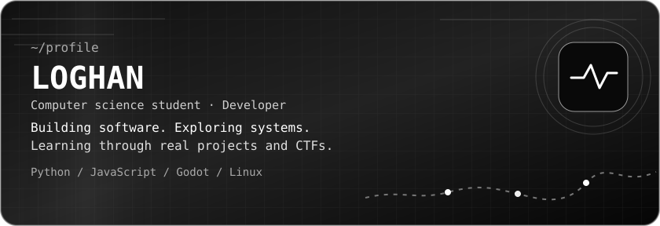

  
  

  

---

### About me

I'm a **17-year-old computer science student** interested in software development, web technologies, Linux, and cybersecurity. I enjoy learning by building projects and taking part in CTF challenges.

### Featured project

**[Console CIEL](https://github.com/loghanmrsn/Console-logiciel)** — A portable educational game console project built with **Godot**, designed around interactive learning experiences.

### Languages & tools

`Python` · `JavaScript` · `HTML` · `CSS` · `Dart` · `SQL` · `GDScript` · `Shell` · `Git` · `Linux`

